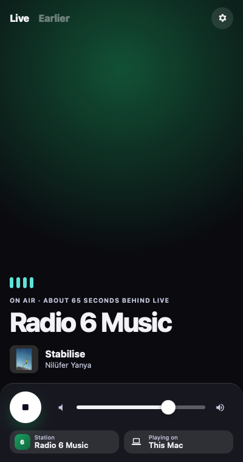
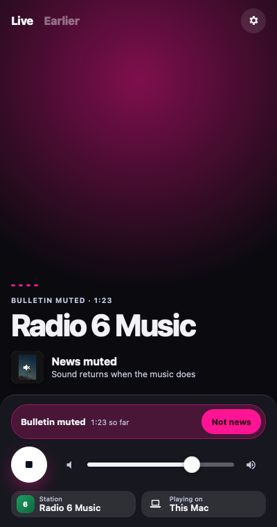
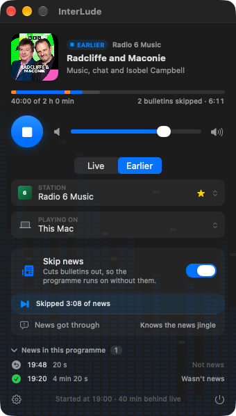
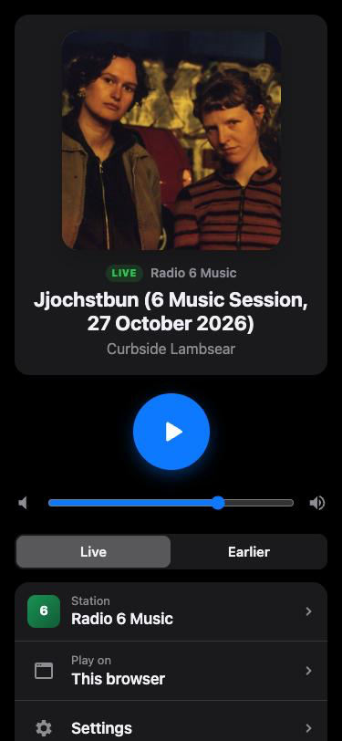
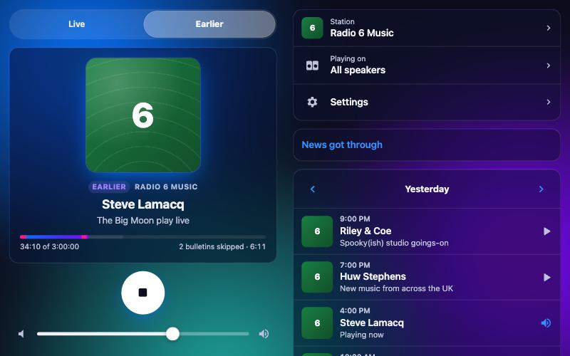

# InterLude

InterLude is a small macOS menu bar app that plays BBC radio about a minute behind live and quietly mutes the news bulletins. It plays on the Mac itself or on Chromecast speakers and groups. It also runs as a web app on a Linux server (see [Running the server](#running-the-server)).

I wanted 6 Music in the background all day without the hourly news, so it is tuned for music stations. Speech stations play normally.

<p align="center">
  
  
  
</p>
<p align="center"><sub>On the Mac: playing live, muting a bulletin, and an earlier programme with the news cut out.</sub></p>

> **Unofficial.** InterLude is not affiliated with the BBC. It relies on stream addresses the BBC does not document and can change at any time. It sends no telemetry: its only network traffic is to BBC servers, and to speakers and browsers on your own network.

## What it does

- Plays any of 64 BBC stations (national, nations and local) a fixed time behind live (60 seconds by default).
- Recognises each bulletin as it arrives and replaces it with silence, or with ocean waves, a woodland stream or birdsong if you prefer. When the bulletin ends, the station comes back.
- Plays on the Mac, on a Chromecast, or on a Cast group, and you can switch speaker while it plays.
- **Earlier** plays a programme from the last 30 days from its start, with the bulletins cut out rather than muted. The last 11 hours come from the live stream; anything older comes from the programme's BBC Sounds episode.
- A phone remote: scan a QR code and control InterLude from a phone on the same Wi-Fi, or from anywhere on your tailnet if the Mac runs Tailscale.
- Learns a station's news theme from the last few hours of broadcast, the first time you play it (so far proven on 6 Music).
- Keeps a log of every decision, so a wrong mute can be explained and the rules improved.
- Runs as a server too: a Docker image for Linux that does all of the above with no Mac, played and controlled from any browser, and casting to Chromecasts itself.

## How it works

The BBC's live streams are HLS: a playlist of 6.4 second audio segments. InterLude downloads the segments itself, analyses them, and serves its own playlist from the Mac to the player. Because it runs about a minute behind live, it has heard each bulletin begin before you do.

A bulletin is found in a few ways, all running on the machine itself:

1. **Speech near the hour or half hour.** Apple's built-in sound classifier scores speech and music every 1.5 seconds. Twenty seconds of sustained speech close to a bulletin slot starts a mute.
2. **The news theme.** InterLude learns the station's news jingle from recent bulletins and starts the mute when it hears it, so the presenter's handover still plays.
3. **The newsreader's words.** While a bulletin is muted, on-device speech recognition listens for the sign-off ("…your next update's at six thirty", "That's 6 Music News for tonight") and ends the mute there, so trails and the presenter's chat afterwards are not lost. If no sign-off is heard, the mute ends when music returns.

The server version does the same with open models in place of Apple's: YAMNet for speech and music, and whisper.cpp for the newsreader. YAMNet's scores are mapped onto Apple's, so the same rules apply to both.

Muted segments are replaced one for one with segments carrying the same timestamps, so the player sees one continuous stream and the delay never drifts. If a mute is wrong, **Not news** brings the sound back within a few seconds, and **News got through** teaches it from a bulletin it missed.

### Earlier programmes

Switch the panel from **Live** to **Earlier**, step back through the days, and pick a programme. It plays from its start:

- **From the live stream** if it began in the last 11 hours or so. The BBC's live origin lists six hours of segments but keeps about eleven, so InterLude fetches them by index.
- **On demand** if it is older (up to 30 days) and has finished. InterLude asks the BBC's media selector for the episode, opens the HLS stream it offers, and lines the episode's segments up with the time they were broadcast, so the detector works exactly as it does live.

Because the whole programme already exists, the analysis runs about ten minutes ahead of you, faster than real time. That leaves time for one more check: InterLude transcribes from a minute before to two minutes after every :00 and :30, and the newsreader's opening starts a bulletin there even when the presenter talked straight into the news. A bulletin is then **left out** rather than silenced, and the segments after it are given timestamps that carry straight on, so the programme simply continues. The panel shows how far through you are, where the news was, and how much has been skipped. Seeking within a programme isn't supported yet.

The details are in [docs/on-demand.md](docs/on-demand.md).

### Phone remote

Turn on **Settings › Phone remote** and point a phone's camera at the QR code. The remote opens in the phone's browser, with nothing to install: play and stop, volume, station, speaker, whether a bulletin is muted, and the **Not news** and **News got through** buttons. Its **Earlier** switch lists each day's programmes from the last 30 days; tap one to play it from the start, and the phone shows how far in you are and how much news was skipped. On an iPhone, Share › Add to Home Screen keeps it as an icon.

The remote is served by the same small web server the Chromecasts use. Its address carries a long random code, so other people on the network can't guess it; **Reset link** makes a new one and the old link stops working. The Mac has to be awake with InterLude open. In Live, Play on the phone plays live; in Earlier it plays the programme last picked from its start, or live if none was. If the Mac's firewall is on, macOS asks once whether InterLude may accept incoming connections.

The design, the measurements behind each rule and the mistakes along the way are written up in [docs/archive/findings.md](docs/findings.md).

## Requirements

- For the Mac app, macOS 26 or later on Apple silicon
- For the server, an x86-64 Linux machine with Docker and about 1 GB of memory free
- The BBC's UK stream addresses, which may not play outside the UK

## Download

Get the zip from the [latest release](../../releases/latest), unzip it and move `InterLude.app` to Applications.

InterLude is signed but not notarised by Apple (that needs a paid developer account), so macOS blocks it the first time:

1. Double-click InterLude. macOS says it can't be opened; click **Done**.
2. Open **System Settings › Privacy & Security** and scroll down to the message about InterLude.
3. Click **Open Anyway**, confirm with your password or Touch ID, then click **Open**.

You only need to do this once. The first time you look for speakers, macOS also asks to let InterLude find devices on your local network; allow it, or Chromecasts won't appear.

If you'd rather not run an app downloaded from the internet, build it yourself instead.

For the server, see [Running the server](#running-the-server).

## Build from source

You'll need Xcode.

```
./scripts/build-app.sh
open build/InterLude.app
```

The script builds `build/InterLude.app` and signs it with your Apple Development certificate if you have one (a free Apple ID is enough), or ad hoc otherwise. A stable signature stops macOS asking for local network permission after every rebuild. `SANDBOX=0 ./scripts/build-app.sh` builds without the App Sandbox.

Builds go to `~/Library/Caches/InterLudeBuild`, because `codesign` rejects files with the extended attributes that iCloud-synced folders such as Documents add.

`./scripts/package-release.sh` builds the app and zips it into `dist/` for a release.

To run the tests you also need ffmpeg and the libraries the server's speech models use, from Homebrew:

```
brew install ffmpeg onnxruntime whisper.cpp
```

Then:

```
DEVELOPER_DIR=/Applications/Xcode.app/Contents/Developer swift test --scratch-path ~/Library/Caches/InterLudeBuild
```

To see the panel's states without playing anything, launch with `--demo=playing`, `--demo=muted`, `--demo=upcoming`, `--demo=error`, `--demo=earlier`, `--demo=earlier-past`, `--demo=replay` or `--demo=settings`.

## Running the server

InterLude also runs as a web app on a Linux machine, so it works with no Mac involved: any phone, tablet or computer plays and controls it in a browser, and it can cast to Chromecasts itself. It uses open models in place of Apple's: YAMNet for speech and music and whisper.cpp for the newsreader, both running on the server's CPU. Nothing is sent to a speech service.

<p align="center">
  
  
</p>
<p align="center"><sub>In a browser: on a phone, and on a computer with yesterday's programmes.</sub></p>

It ships as a Docker image for x86-64 Linux. You need Docker with Compose, and about 1 GB of memory free.

```
mkdir interlude && cd interlude
curl -fsSLO https://raw.githubusercontent.com/MstrThePlague/InterLude/main/compose.yaml
docker compose pull && docker compose up -d
docker compose logs | grep "Open the app"
```

The log gives the app's address, `http://<server>:8642/app/<code>/`. The long code keeps other people on your network out; **Settings › Reset link** makes a new one. Open it on a phone and add it to the Home Screen to keep it as an app. Settings also shows a QR code for opening it on another device.

The server starts playing when a browser asks for it and stops 10 minutes after the last one stops listening. Play and Stop act on the browser you press them in. With a Cast speaker chosen, they start and stop the speaker instead.

**Your network.** Browsers on your LAN reach the server on TCP 8642. Cast speakers need two more things:

- **The stream:** the speakers must be allowed to fetch it from the server on TCP 8642.
- **Discovery:** the server must see the speakers' multicast DNS, port 5353. On a network split into VLANs, add the server's network to the gateway's mDNS proxy or reflector.

If the server runs a firewall such as ufw, allow those ports in from your networks.

**Away from home.** With Tailscale on the server, serve the app over HTTPS on your tailnet:

```
sudo tailscale serve --bg --https=8443 http://127.0.0.1:8642
```

Then open `https://<server's tailnet name>:8443/app/<code>/`. Cast speakers still use the LAN address.

**Updating:** `docker compose pull && docker compose up -d`. Each release tag publishes the image as `ghcr.io/mstrtheplague/interlude-server`. To build from a checkout instead: `docker compose up -d --build`.

**Backing up.** Settings, station profiles and learned news jingles live in the `data` volume. To copy them out:

```
docker run --rm -v interlude_data:/data -v "$PWD":/backup alpine tar czf /backup/interlude-data.tgz -C /data .
```

The volume is named after the folder `compose.yaml` is in, so for a folder called `interlude` it's `interlude_data`. Run `docker volume ls` to check. A jingle the Mac app has learned can be copied across: put its `profiles/<station>.json` and `.candidates` files into the volume's `profiles` folder and restart.

**Comparing with the Mac.** To check the server against the Mac app, turn on `INTERLUDE_KEEP_RUNNING` in `compose.yaml`; the server then runs the live session all the time. Leave the Mac app playing the same station, and after a few days compare the two event logs:

```
scripts/compare-events.py ~/"Library/Containers/org.benbull.InterLude/Data/Library/Application Support/InterLude/events.jsonl" server-events.jsonl
```

To get `server-events.jsonl`, run `docker compose cp interlude:/var/lib/interlude/events.jsonl server-events.jsonl`.

## Where things are kept

| File | What it holds |
|---|---|
| `Application Support/InterLude/stations.json` | The station list and stream address template. Edit a station's pool ID here if the BBC changes it. |
| `Application Support/InterLude/profiles/` | Per-station settings, bulletin minutes and the learned news theme. |
| `Application Support/InterLude/events.jsonl` | One line per detected bulletin and per correction. Settings › Export diagnostics zips these up. |

Inside the App Sandbox, `Application Support` is the app's own container under `~/Library/Containers`.

The server keeps the same files in its `data` volume (`/var/lib/interlude` in the container), plus `settings.json`, which holds its settings and the code in the app's link.

## Project layout

| Folder | Contents |
|---|---|
| `Sources/InterLudeCore` | Everything that isn't user interface or tied to Apple's frameworks: stream handling, MPEG-TS, detection, playout, the phone remote's page and the Cast protocol. Builds and tests on Linux too. |
| `Sources/InterLudeApple` | The Mac's implementations of what the core asks the platform for: AAC decoding and encoding, the sound classifier, speech recognition, signal maths, the local server and Cast discovery. |
| `Sources/InterLudePortable` | Implementations that work away from the Mac, on Linux and Windows: decoding and encoding audio with ffmpeg. |
| `Sources/InterLudeHTTP` | The web server for macOS and Linux, on Hummingbird. |
| `Sources/InterLudeML` | The server's speech models: YAMNet on ONNX Runtime for speech and music, whisper.cpp for the newsreader. `scripts/yamnet` converts and calibrates YAMNet. |
| `Sources/InterLudeCast` | Casting from Linux: a Chromecast client on SwiftNIO and a multicast DNS browser for finding speakers. |
| `Sources/COnnxRuntime`, `CWhisper`, `CGGML` | Module maps that let Swift call the ONNX Runtime, whisper.cpp and ggml C libraries. |
| `Sources/InterLudeServer` | `interlude-server`, InterLude as a web app on a Linux host. `Dockerfile` and `compose.yaml` build and run it; `interlude-server --check <audio>` runs its models on a file. |
| `Sources/InterLudeApp` | The SwiftUI menu bar app. |
| `Web` | The server's app icons. Its page is the phone remote's, in `Sources/InterLudeCore/Remote.swift`. |
| `Tests` | Unit tests for the parts that can be tested without a network or speakers. |
| `Tools` | Command-line programs used to measure and tune detection (below). |
| `docs` | Notes on on-demand playback, release notes and screenshots. `docs/archive` holds the findings and manual test checklists from early development. |
| `scripts` | Building and packaging the Mac app, installing the server's native libraries on Linux, preparing YAMNet, and comparing two event logs. |

### Tools

Run with `swift run --scratch-path ~/Library/Caches/InterLudeBuild <name>`. Recordings are for personal testing and are kept out of git.

| Tool | Use |
|---|---|
| `record <serviceId> <hoursAgo> <minutes> <dir>` | Save segments from the BBC's six hour rewind window. |
| `classify <dir> <csv>` | Speech and music scores for a recording. `CLASSIFIER=yamnet:<models dir>` scores with the server's YAMNet instead (`YAMNET_RAW=1` before calibration). |
| `evaluate <csv> [labels.json] [profile.json]` | Replay the speech rule over scores and report accuracy against labelled bulletins. |
| `ident-check` | Find and test a station's news theme in recordings. `PLATFORM=portable` decodes with ffmpeg and uses the server's signal maths. |
| `signoff-check` | Transcribe bulletins and report where the newsreader opens and signs off. `WHISPER=<model file>` uses whisper.cpp, as the server does. |
| `serve <serviceId> [delay] [port]` | A session without the app, for testing with ffmpeg or curl. `REPLAY=<ISO time>` plays from that broadcast time instead; add `VERSION=<pid>` to play that BBC Sounds version on demand and `OFFSET=<seconds>` to start part way in. |
| `cast-spike list` / `play <device> <url>` | List Cast speakers and groups, or play a stream on one. |

## Sounds

The sounds offered in place of bulletins are trimmed from recordings by Joseph Sardin at [BigSoundBank](https://bigsoundbank.com), released into the public domain (CC0): sea waves #0698, forest and stream #2 #2714, and forest #3 #2715.

## Third-party software

The server is built with Hummingbird and SwiftNIO (Apache 2.0). Its image also includes:

- YAMNet, Google's AudioSet classifier, converted to ONNX (Apache 2.0)
- whisper.cpp and its base.en model (MIT)
- ONNX Runtime (MIT)
- ffmpeg, from Ubuntu (LGPL and GPL)
- hls.js (Apache 2.0) and qrcode-generator (MIT), for the web page

## Licence

MIT. See [LICENSE](LICENSE).

BBC audio, artwork and logos are the BBC's and are never stored in this repository. Album art and track names shown in the panel and the web app are fetched from the BBC while they run.
